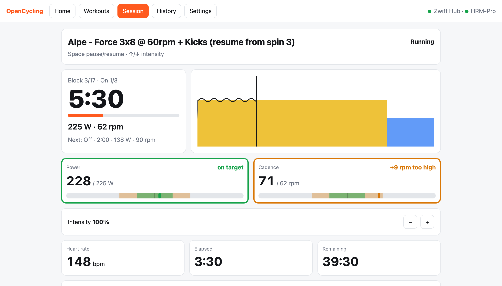
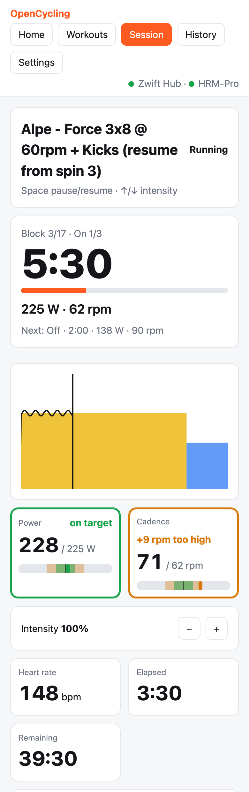
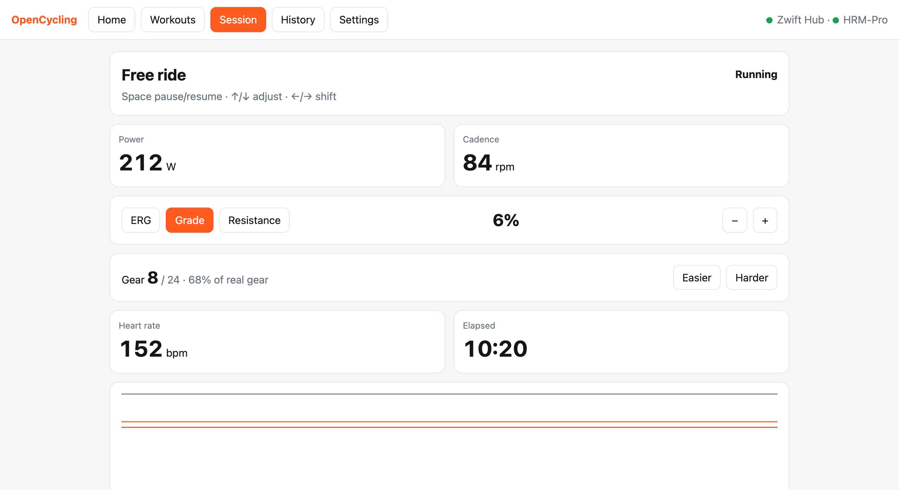

# OpenCycling Web

A browser port of [OpenCycling](https://github.com/TheElysium/opencycling), in one HTML file. It also borrows a few ideas from [Auuki](https://github.com/dvmarinoff/Auuki).

It runs structured `.zwo` workouts in ERG mode on a Bluetooth smart trainer (FTMS), records each session in the browser, and exports TCX.

<p>
  
  
</p>
<p></p>

The values in these screenshots are simulated.

## Run

Web Bluetooth needs Chrome or Edge on desktop or Android, and an https or localhost origin.

```bash
python3 -m http.server 8765
```

Then open http://localhost:8765. No trainer? Click **Use simulator**.

## Features

- Trainer (FTMS), heart rate strap (HRS) and power meter (CPS) over Web Bluetooth. A power meter replaces the trainer's power reading.
- `.zwo` workouts: pedal to start, auto-pause when you stop pedalling, a 5 s ramp back up on resume, skip block, audio cues.
- A focus card for the current block (big countdown, targets, next block) and power and cadence gauges against the target.
- Intensity bias during a workout (↑/↓), Space to pause and resume, screen kept awake.
- Free ride in ERG, grade or resistance mode, with 24 virtual gears in grade mode (for a single-speed like the Zwift Cog).
- Zwift Click / Play / Ride buttons: shift gears in grade mode, adjust intensity or watts otherwise (reverse-engineered protocol, unencrypted mode).
- History with NP, IF, TSS, power graph, power and heart rate zones, and TCX export.

Everything is stored in the browser's localStorage.

## Not ported

From OpenCycling: training plans, FTP ramp test, webcam aero detection, Strava upload, Bluetooth auto-reconnect.
From Auuki: FIT recording, ANT+, intervals.icu, PWA install.

## Credits

- [OpenCycling](https://github.com/TheElysium/opencycling) by TheElysium (GPL-3.0): the session state machine, auto-pause and ramp logic, metrics and workout model are ported from its Rust and Svelte code.
- [Auuki](https://github.com/dvmarinoff/Auuki) by dvmarinoff (AGPL-3.0): the ideas for the power meter source, free ride modes, intensity bias, keyboard controls and screen wake lock, and its FTMS simulation defaults. Its code was used as a reference; none is copied here.
- [zwiftplay](https://github.com/ajchellew/zwiftplay) and [BikeControl](https://github.com/OpenBikeControl/bikecontrol): the community reverse engineering of the Zwift Click, Play and Ride protocol.

Not affiliated with Zwift. Zwift, Zwift Click and Zwift Cog are trademarks of Zwift, Inc.

## License

GPL-3.0-or-later, the same license as OpenCycling, which this file ports.
